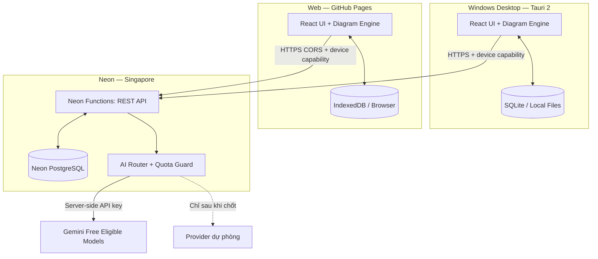
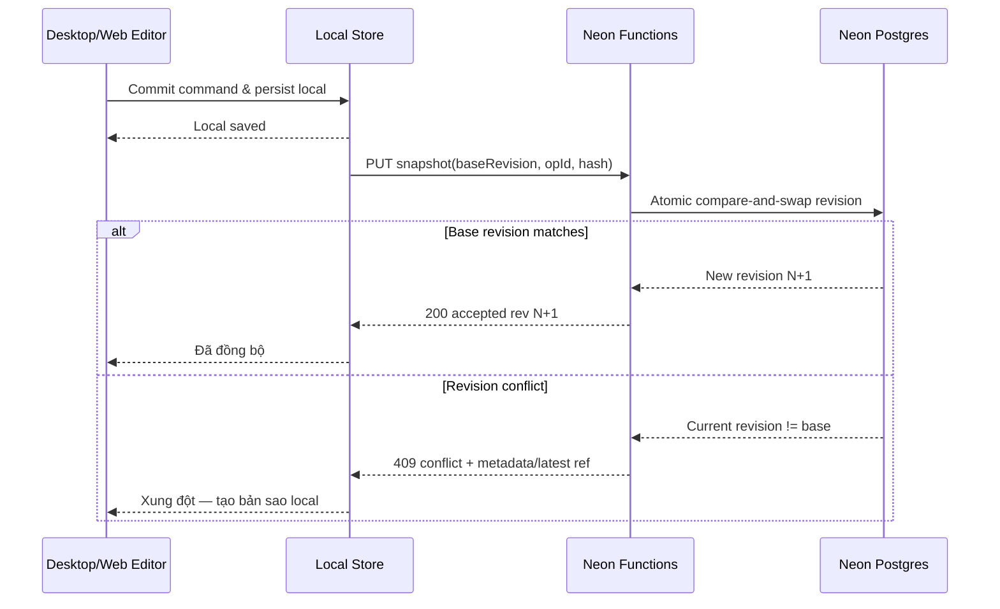
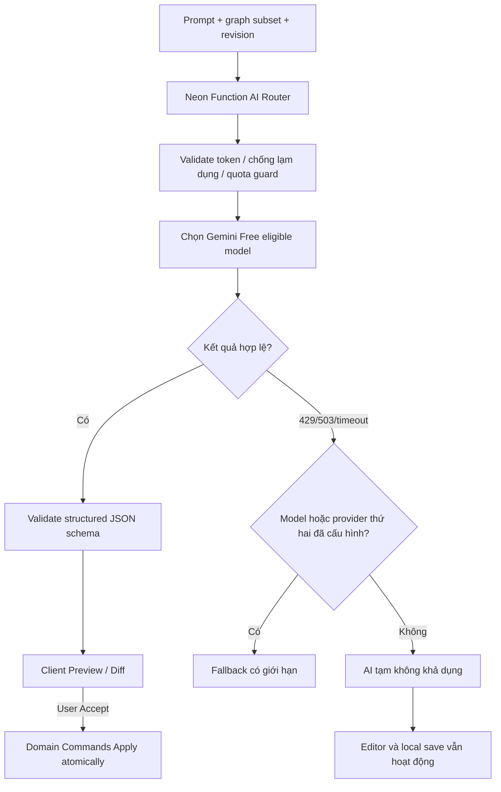

# DiagramAI — PLAN.md

> **Bản:** 2.0 — Kiến trúc Desktop + Web + Neon, thay thế kế hoạch dùng Cloudflare Pages/D1/Workers.  
> **Ngày cập nhật:** 18/11/2026.  
> **Trạng thái:** Tài liệu kỹ thuật/triển khai để giao Codex hoặc đội phát triển; chưa có mã nguồn sản phẩm hoàn chỉnh.  
> **Nền tảng:** Windows 11 Desktop (.exe) + Web trên GitHub Pages, **dùng chung giao diện và engine**.  
> **Backend:** **Neon PostgreSQL + Neon Functions**, project Neon tên `DiagramAI` đã được người dùng tạo, region Singapore theo cấu hình được chọn. Chưa có project ID/URL/credential trong tài liệu.  
> **Định hướng:** Giao diện giữ theo mockup v1.0 · không đăng nhập · local-first · đồng bộ hai chiều sau khi ghép nối · AI có kiểm soát · ưu tiên miễn phí.

---

## 0. QUYẾT ĐỊNH ĐÃ CHỐT — KHÔNG TỰ Ý THAY ĐỔI

| ID | Quyết định | Mức độ |
|---|---|---|
| D01 | Tên sản phẩm: **DiagramAI**. Công cụ vẽ sơ đồ đơn giản hơn draw.io, có AI. | Đã chốt |
| D02 | **Giao diện tham chiếu là file `DiagramAI_Mockup.html`**; giữ bố cục, phong cách, màu sắc và cách sử dụng. | Đã chốt |
| D03 | Chỉ cần bộ hình khối **General** và các công cụ cơ bản đã thống nhất, không mang toàn bộ thư viện draw.io. | Đã chốt |
| D04 | Rê chuột vào hình làm xuất hiện **điểm kết nối**; kéo từ hình A sang B để tạo đường nối gắn với ID/handle. | Đã chốt |
| D05 | Di chuyển/resize A hoặc B, đường nối **không đứt**, tự cập nhật theo hình. | Đã chốt |
| D06 | Kéo một hình C vào đường nối A→B sẽ tự thay bằng **A→C→B**, giữ hướng luồng và hoàn tác được. | Đã chốt |
| D07 | Kéo thả, bắt dính, phím tắt, Undo/Redo, zoom/pan và chọn đối tượng phải mượt. | Đã chốt |
| D08 | **Nhấp đúp vào hình để sửa chữ trực tiếp**, không dùng `window.prompt()` trong bản phát hành. | Đã chốt |
| D09 | Tab **Thuộc tính**: tô màu nền, màu viền, màu chữ, độ dày viền, kích thước; hỗ trợ nhiều đối tượng khi phù hợp. | Đã chốt |
| D10 | **Desktop và Web tương đương chức năng vẽ và AI**, chia sẻ domain model và phần lớn mã nguồn. | Đã chốt |
| D11 | **Web mở vào editor ngay, không cần đăng nhập.** Desktop cũng không yêu cầu tài khoản. | Đã chốt |
| D12 | **Desktop ↔ Web đồng bộ hai chiều**, có thể vẽ dở trên Desktop rồi mở Web vẽ tiếp, và ngược lại. | Đã chốt |
| D13 | Hosting Web: **GitHub Pages**; **không dùng Cloudflare Pages**. | Đã chốt |
| D14 | Backend/dữ liệu: **Neon PostgreSQL + Neon Functions**, **không dùng D1 hoặc tự triển khai Cloudflare Worker**. | Đã chốt |
| D15 | Không yêu cầu Object Storage, Neon AI Gateway, Realtime, Better Auth cho v1; chỉ bật Postgres + Functions. | Đã chốt hiện tại |
| D16 | AI ưu tiên **Gemini API Free**; phần điều phối có khả năng đổi model/provider khi quota hợp lệ cạn. Không tự phát sinh phí. | Đã thống nhất về nguyên tắc |
| D17 | Không cần cộng tác nhiều người realtime trong v1.0; đồng bộ qua phiên bản dự án, không giả lập Google Docs. | Đã thống nhất |
| D18 | Build Windows bằng **`build.bat` một lần bấm**, ít thao tác thủ công; xuất gói Desktop Light và thư mục Web, không tự ZIP. | Quy chuẩn triển khai |

### Phần **chưa chốt** (không được tự giả định thành yêu cầu)

1. Nhà cung cấp AI dự phòng **ngoài Gemini**: đã từng cân nhắc Workers AI, nhưng hiện đã quyết định **không dùng Worker** làm backend. Bản này **không cấu hình Cloudflare Workers AI**; để interface `SecondaryAIProvider` và cấu hình tắt, chờ quyết định riêng. Có thể fallback qua model Gemini Free khác khi hợp lệ; việc hết quota cấp project không được khẳng định là đổi model luôn giải quyết được.
2. Tên GitHub repository, URL GitHub Pages, project ID/branch URL Neon, tên domain riêng: **chưa cung cấp**; dùng placeholder, không tự suy đoán hoặc tạo thật.
3. Mức giới hạn AI cho khách truy cập ẩn danh, thời gian lưu lịch sử và mục tiêu hiệu năng: các số dưới đây là **đề xuất kỹ thuật có thể cấu hình**, không phải quota cam kết từ nhà cung cấp.
4. GitHub Pages phù hợp cho thử nghiệm/công cụ phi thương mại; nếu phát triển dịch vụ SaaS thương mại phải đánh giá lại điều khoản hosting, không mặc định GitHub Pages dùng lâu dài cho mọi mô hình kinh doanh.

### Tài liệu tham chiếu bắt buộc

- `design/reference/DiagramAI_Mockup.html` — **nguồn giao diện v1.0 đã duyệt**, có HTML/CSS/JS tương tác.
- `design/reference/DiagramAI_Preview.png` — ảnh đối chiếu visual.
- `plan.md` — nguồn sự thật về yêu cầu, kiến trúc, phase, điều kiện nghiệm thu.
- `docs/decisions/` — nhật ký thay đổi quyết định (ADR); không tự sửa quyết định đã chốt.

> **Nguyên tắc 1:** Web không đăng nhập ≠ không có bảo vệ dự án. Đồng bộ phải dựa vào **khóa truy cập dự án/token thiết bị**, không phải cơ sở dữ liệu công khai.  
> **Nguyên tắc 2:** “Đã lưu trên máy” ≠ “Đã đồng bộ lên Neon”. Hai trạng thái phải phân biệt bằng UI.  
> **Nguyên tắc 3:** Hết quota AI không làm ngừng editor, lưu local hay mở file.

---

## 1. MỤC TIÊU SẢN PHẨM VÀ PHẠM VI

### 1.1. Mục tiêu

- Vẽ nhanh sơ đồ quy trình, công việc, kho/sản xuất, tổ chức và kỹ thuật bằng bộ hình khối gọn.
- Người mới dùng có thể thao tác mà không học một bộ công cụ đồ sộ.
- Người dùng tạo/sửa sơ đồ trên **Windows .exe** và **Web** với trải nghiệm giống nhau.
- Tự lưu local ngay cả khi offline; tự đồng bộ cloud khi được liên kết và có mạng.
- AI hiểu **dữ liệu cấu trúc node/edge**, không biến sơ đồ thành ảnh mất khả năng chỉnh sửa.
- Dùng chi phí tối thiểu ở giai đoạn cá nhân/thử nghiệm; kiểm soát lạm dụng quota AI vì Web mở không đăng nhập.

### 1.2. Có trong bản v1.0

- Editor node/edge; hình khối General; nối, tách đường nối, nhấp đúp sửa chữ, màu sắc, căn chỉnh, thao tác bàn phím.
- Tạo/mở/lưu file `.diagramai`; export SVG/PNG; export PDF qua cơ chế in hoặc thư viện được kiểm chứng.
- Desktop và Web cùng định dạng file; auto-save local (Desktop SQLite, Web IndexedDB).
- Neon Sync (sau khi người dùng chủ động bật và ghép nối); hiển thị trạng thái, phát hiện xung đột, lưu lịch sử có giới hạn.
- AI qua Neon Functions: tạo sơ đồ, thêm/sửa node, chèn giữa edge, phân tích logic, gợi ý bố cục; preview trước khi apply.
- Web GitHub Pages không đăng nhập, mở thẳng editor; khi người dùng không có mã ghép nối vẫn được vẽ và lưu **local trên trình duyệt đó**.
- Windows x64, Chrome/Edge desktop phiên bản hiện đại; giao diện tiếng Việt.

### 1.3. Không có trong bản v1.0

- Đồng biên tập realtime/con trỏ nhiều người.
- Chat AI offline bằng model chạy tại máy.
- Toàn bộ bộ shape draw.io, nhập Visio, chỉnh trực tiếp `.drawio` hoàn chỉnh.
- Quyền chia sẻ công khai để ai có link cũng sửa; thư viện template cộng đồng, thanh toán, tài khoản nhiều người.
- Android/iOS native; chỉnh sửa trên màn hình điện thoại không phải mục tiêu chính.
- Cam kết chạy đồng bộ khi **đã tắt hẳn ứng dụng Desktop**. Sync v1 hoạt động khi app còn chạy; có thể bổ sung background service sau.

### 1.4. Kịch bản hoàn thành mẫu

1. Trên Desktop tạo A→B, nhấp đúp sửa tên, tô màu, nối hình.
2. Kéo C vào đường A→B, hệ thống chuyển thành A→C→B; Ctrl+Z phục hồi A→B.
3. Nhấn **Bật đồng bộ**: Desktop tạo vùng lưu cloud và hiển thị **mã ghép nối một lần**.
4. Trên Web GitHub Pages (không đăng nhập), mở editor, chọn **Liên kết dự án**, nhập mã; Web tải bản đã đồng bộ từ Neon.
5. Chỉnh tiếp C→D trên Web; khi đồng bộ thành công, Desktop nhận phiên bản mới.
6. Mất Internet: cả hai vẫn lưu local; nếu cả hai đã thay đổi riêng, xuất hiện nhánh **xung đột**, không ghi đè mất nội dung.
7. Dùng AI thêm một bước; AI trả đề xuất, xem trước → áp dụng; hoàn tác toàn bộ trong một lần.

---

## 2. KIẾN TRÚC TỔNG THỂ



### 2.1. Nguyên tắc phân lớp

1. **Một engine và một UI** (`packages/editor`, `packages/ui`) được nhúng vào cả Desktop và Web.
2. **Domain model độc lập React Flow** (`packages/diagram-core`) là dữ liệu chuẩn được lưu và đồng bộ.
3. **Platform adapters** khác nhau ở I/O: Desktop ↔ SQLite/OS file, Web ↔ IndexedDB/Blob download.
4. **API backend tại Neon Functions** kiểm tra quyền truy cập, revision, quota, gọi Gemini; không đưa `DATABASE_URL` hay `GEMINI_API_KEY` vào frontend.
5. **Cloud là lớp bổ sung**: editor có thể chạy hoàn toàn local khi API lỗi.
6. **Không trực tiếp truy vấn PostgreSQL từ trình duyệt/EXE bằng database connection string**.

### 2.2. Vòng đời ứng dụng

- **Khởi động lần đầu:** tải editor, tạo local guest device ID, mở trang vẽ ngay; không hiện màn hình login.
- **Tạo sơ đồ:** thao tác → domain transaction → commit vào state → persist local → xếp vào outbox nếu đã liên kết cloud.
- **Nhận đồng bộ:** tải snapshot server có revision cao hơn → chỉ apply khi local không có pending changes; nếu có, xử lý conflict.
- **Dùng AI:** gửi prompt + phạm vi node/edge cần thiết → server giới hạn → model trả JSON → server validate → client preview → commit như thao tác tay.
- **Mở app ở máy khác:** phải ghép nối/khôi phục bằng key; không thể tự liệt kê dự án của một người khi không có login.

---

## 3. STACK KỸ THUẬT VÀ LÝ DO CHỌN

| Tầng | Chọn | Vai trò/Ghi chú |
|---|---|---|
| Ngôn ngữ UI | **TypeScript + React + Vite** | Dùng chung mã nguồn, build static lên GitHub Pages |
| Editor canvas | **`@xyflow/react` v12** (pin lockfile) | Node, edge, handles, drag, zoom, pan, selection; khóa version ổn định trước khi tính nâng cấp v13 |
| Shape | **SVG custom** | Vẽ bộ General theo mockup, text editable trực tiếp |
| Bố cục | **`elkjs`** tùy chọn | Auto layout theo lệnh, không tự xáo trộn sơ đồ người dùng |
| State | Zustand hoặc store TS có transaction | Document/UI/history/sync tách biệt |
| Validate | Zod + rule engine | Project schema, graph, command từ AI, API payload |
| Local Desktop | **SQLite qua Tauri plugin** + native file dialog | Cache tài liệu, outbox, revision, auto-save |
| Local Web | **IndexedDB**, ví dụ Dexie | Tài liệu local + queue đồng bộ khi trang đang chạy |
| Windows EXE | **Tauri 2 + WebView2** | Trải nghiệm native shell, NSIS installer, bundle light |
| Web hosting | **GitHub Pages** | Chỉ host static React build; **không chạy backend** |
| Backend | **Neon Functions** (Node.js/TypeScript) | HTTP API sync/AI, đặt tại branch của Neon project |
| Cloud DB | **Neon PostgreSQL** (JSONB) | Project, revision, capability hash, device, audit/AI usage |
| AI primary | **Gemini API Free** có model đủ điều kiện | Structured JSON commands, API key server-side |
| AI secondary | Adapter `SecondaryAIProvider` **tắt theo mặc định** | Chỉ bật sau khi duyệt nhà cung cấp và điều khoản |
| Testing | Vitest + RTL + Playwright | Unit, integration, E2E, visual regression |
| CI/CD Web | GitHub Actions → GitHub Pages | Build, test, publish static dist |
| Backend deploy | Neon CLI / Neon config | Deploy functions/migrations riêng, secrets do server quản lý |
| Build Desktop | `build.bat` trên Windows 11 | Một lần bấm, tự kiểm tra dependency, build NSIS Light và Web |

**Không dùng:** Cloudflare Pages, D1, Cloudflare Worker, Neon AI Gateway, Object Storage, Better Auth, Neon Realtime trong giai đoạn đầu. Chúng không phải phụ thuộc ngầm. Backend có thể đổi nhà cung cấp trong tương lai nhờ interface ở `packages/sync-core`.

### 3.1. Lưu ý version

- React Flow 13 được công bố 16/11/2026 với breaking changes. **Pin v12** trong lockfile cho v1.0, đánh giá upgrade sau khi editor ổn định.
- Neon Functions còn ở giai đoạn beta trong năm 2026; phải thực hiện **spike kiểm thử ở P0** về endpoint, CORS, secrets, xử lý lỗi và miễn phí trước khi phụ thuộc triển khai sản phẩm.
- Không ghi số quota Gemini hoặc Neon cố định như cam kết lâu dài: **đọc bảng hạn mức trên dashboard tại ngày deploy**, kiểm thử thực tế.

### 3.2. License

- Lõi React Flow được cấp phép mở; kiểm tra license, attribution và mọi gói Pro trước khi phân phối.
- Không sao chép nguyên bộ thư viện icon/stencil draw.io hoặc trả tiền cho gói Pro khi chưa được duyệt.
- Lưu `THIRD_PARTY_NOTICES.md` và lockfile theo release.

---

## 4. HỢP ĐỒNG GIAO DIỆN — KHÓA THEO MOCKUP V1.0

### 4.1. Vùng giao diện

| Vùng | Thiết kế chốt | Cách hiện thực |
|---|---|---|
| Topbar | Logo DiagramAI, tên dự án, trạng thái lưu/cloud, Mở/Lưu/Xuất | Giữ CSS token/layout từ mockup; thật hóa các nút |
| Rail trái | Nhóm công cụ nhỏ dạng icon | Tool state, keyboard shortcuts, tooltip |
| Palette trái | Tìm kiếm, các nhóm **CƠ BẢN / QUY TRÌNH / ĐƯỜNG NỐI** | Dữ liệu shape registry, drag-to-canvas |
| Toolbar canvas | Chọn/di chuyển/nối/văn bản, Undo/Redo, zoom | React Flow controls tùy biến theo mockup |
| Canvas | Nền sáng/grid chấm, node/edge, selection | React Flow + custom shape/edge |
| Sidebar phải | Tab **Trợ lý AI** / **Thuộc tính** | Điều khiển theo selection, không mở panel mới gây rối |
| Footer | Tổng node/edge, zoom, trạng thái thực tế | Bind với state + sync state |
| Trạng thái cloud | Hiển thị kiểu chip nhỏ trên topbar | Modal riêng cho ghép nối/xung đột, không thay layout |

**Không được:** đổi layout thành template dashboard mới; thêm ribbon phức tạp; đổi màu chủ đạo/icon/spacing vì “cho đẹp hơn”; bỏ tab Thuộc tính; tự ép đăng nhập Web.

### 4.2. Các trạng thái UI phải hiển thị đúng

- `Đã lưu trên máy` — local transaction đã persist thành công.
- `Đang đồng bộ…` — đang gửi/nhận revision.
- `Đã đồng bộ` — server xác nhận revision mới nhất và outbox trống.
- `Offline · Chờ đồng bộ` — local đã lưu nhưng không thể gửi.
- `Xung đột` — có hai nhánh chỉnh sửa; tuyệt đối không dùng từ “đã đồng bộ”.
- `Lỗi đồng bộ` — API/auth/quota/validation lỗi; vẫn có thể vẽ.
- `Chỉ lưu local` — người dùng chưa bật cloud/link.

### 4.3. Thuộc tính hình khối

- Nhấp 1 lần chọn node; hiện resize handles và thuộc tính.
- Nhấp đúp vào text/hình để chuyển sang chế độ sửa text **inline**; Enter xác nhận (Shift+Enter xuống dòng nếu là multi-line), Esc hủy.
- Thuộc tính node: nhãn, font, cỡ chữ, màu nền (preset + color picker), màu viền, màu chữ, độ dày/kiểu viền, width/height, vị trí, lớp trước/sau.
- Thuộc tính edge: nhãn cạnh, màu, độ dày, kiểu line, start/end arrow, routing style.
- Multi-select: thay đổi màu nhiều hình đồng thời; những thuộc tính không phù hợp thì trạng thái mixed.
- Không yêu cầu custom fill gradient ở v1, không làm lệch style mockup.

### 4.4. Chống lệch mockup

- Commit nguyên `DiagramAI_Mockup.html` và ảnh preview vào `design/reference/`.
- Chụp Playwright ở 1366×768, 1920×1080; review diff trước khi PASS từng phase UI.
- Hỗ trợ 1280×720 bằng panel co giãn/thu gọn mà **không đổi bố cục cơ bản**.
- Ưu tiên chuột + bàn phím Desktop; Web mở trên điện thoại xem sơ đồ cơ bản, chỉnh sửa cảm ứng sâu để phase sau.

---

## 5. ĐẶC TẢ ENGINE VẼ (ƯU TIÊN CAO NHẤT)

### 5.1. Bộ shape

Registry theo tham chiếu mockup (không tự thêm 100 hình):

- **Cơ bản:** rectangle, rounded rectangle, ellipse, circle, diamond, parallelogram, hexagon, triangle, cylinder/database, cloud, document, speech bubble, text.
- **Quy trình / biến thể General:** các shape cửa sổ, tài liệu, sơ đồ con, lưu trữ, thủ công… chỉ những mục có trong mockup và ảnh General đã chốt.
- **Kết nối:** straight, orthogonal/step, smooth-step/curved; arrow heads, dashed/solid, edge labels.
- Trước khi code đăng ký shape, trích **danh sách thật** từ `DiagramAI_Mockup.html` (`SHAPES` registry), đối chiếu ảnh General; không suy đoán từ tên dạng gần giống.

Mỗi shape có: `type`, `defaultSize`, `minSize`, `svgPath`/renderer, `ports`, `textRegion`, `resizePolicy`, `styleDefaults`.

### 5.2. Neo và đường nối sống

- Khi hover một node, hiển thị 4 neo mặc định `top/right/bottom/left`; có thể tính thêm neo động về sau.
- Kéo từ source handle → hover target → hiển thị preview → thả tạo edge mang `sourceNodeId`, `sourcePortId`, `targetNodeId`, `targetPortId`.
- Khi node di chuyển/resize, edge tính lại điểm đầu/cuối từ handle tương ứng.
- Nếu xóa node, các edge liên quan được xóa trong **một transaction** (hoặc theo lệnh nối tắt rõ ràng); không để dangling reference.
- Cho phép đổi neo/đổi hướng của edge nhưng không gán nhầm target.

### 5.3. Kéo hình chèn giữa đường nối

**Tiêu chuẩn bắt buộc:**

```text
Trước: Node A --[Edge e1]--> Node B
Kéo Node C vào hit-area của e1
Sau:  Node A --[Edge e2]--> Node C --[Edge e3]--> Node B
```

Quy trình nguyên tử:

1. Từ pointer event convert `screen coordinates` sang flow-space (tính cả pan/zoom).
2. Hit test **đường vẽ thật** với tolerance theo pixel màn hình (không chỉ bbox). Highlight đoạn edge sắp chèn.
3. Khi drop, xác định node đang kéo hoặc tạo mới từ palette; kiểm tra node C không phải đầu/cạnh cùng ID, không self-loop vô ý.
4. Tạo command `InsertNodeOnEdge` có `edgeId`, `nodeData` và `position`.
5. Validate sơ đồ/version; xóa e1, tạo e2/e3, giữ `direction`, `lineStyle`, `stroke`, `arrowEnd` phù hợp; nhãn e1: có chính sách giữ về e2 mặc định và thông báo nếu nhãn điều kiện cần gán lại (không tự nhân đôi chữ “Có/Không”).
6. Căn chỉnh hoặc layout cục bộ, không đảo toàn sơ đồ.
7. Push một history transaction; **Ctrl+Z một lần** phục hồi hoàn toàn e1 và vị trí node.

Nếu drop trượt khỏi edge, chỉ thả node bình thường, **không** tự nối sai. Khi node đã có nhiều cạnh, không tự chèn nếu gây ambiguities mà không hỏi/hiển thị preview.

### 5.4. Smart routing & snapping

- Snap-to-grid configurable, mặc định bật; snap cạnh/tâm của node khác với guideline.
- Edge tránh xuyên qua node ở chế độ orthogonal **trong mức thuật toán hỗ trợ**, có fallback đường thẳng/từng đoạn khi routing thất bại.
- Thay đổi vị trí node không reset thủ công các đoạn đường vừa được người dùng điều chỉnh nếu có điểm kiểm soát.
- Thứ tự ưu tiên: **đúng kết nối và không mất edge > không chồng node > đẹp**.
- Dùng `elkjs` cho auto-layout khi có lệnh; nếu đường nối tránh vật cản chưa đủ tốt, nghiên cứu thư viện routing riêng. Không tự tuyên bố “giống draw.io 100%”.

### 5.5. Selection, resize, phím tắt

| Thao tác | Kết quả |
|---|---|
| Click | Chọn node/edge |
| Shift+Click / marquee | Chọn nhiều |
| Double click | Sửa text inline |
| Ctrl+C, Ctrl+V, Ctrl+X | Sao chép/dán/cắt đối tượng |
| Ctrl+D | Nhân đôi |
| Ctrl+Z / Ctrl+Y; Ctrl+Shift+Z | Undo/Redo |
| Ctrl+A | Chọn toàn bộ đối tượng trong canvas |
| Delete/Backspace | Xóa selection |
| Ctrl+S | Lưu local; desktop hỗ trợ Save File; không ép tải file mới mỗi lần autosave |
| Space + Drag hoặc công cụ Pan | Di chuyển canvas |
| Wheel + modifier / toolbar | Zoom theo mức đúng và nhất quán |
| Arrows / Shift+Arrows | Di chuyển node theo bước nhỏ/lớn (không khi đang gõ text) |
| Esc | Thoát mode / hủy edit / bỏ selection |

- Không bắt phím tắt khi focus trong text input, textarea, modal hay contenteditable.
- Edge selection, text edit, drag, resize, palette drop, AI apply đều có **Undo/Redo rõ ràng**.
- Command history có khả năng serialize transaction mô tả, nhưng **không** đưa UI-only selection vào document JSON.

### 5.6. Cấu trúc engine phải tách rõ

```text
packages/diagram-core/
  domain/       Node, Edge, Document, Style, Constraints
  commands/     AddNode, MoveNode, Connect, InsertOnEdge, Delete, EditText...
  validators/   VerifyPorts, UniqueIDs, ReferentialIntegrity, Caps...
  history/      TransactionLog, Undo/Redo
packages/editor/
  canvas/       ReactFlow adapter, zoom/pan, hit test
  renderers/    Shape SVG, Edge SVG, inline editor
  interactions/ HoverHandles, drag/drop, selection, snapping
```

**Quan trọng:** cùng command dùng cho thao tác người dùng và **AI proposal**. AI không được thao túng DOM hoặc ghi thẳng vào state React Flow.

---

## 6. ĐỊNH DẠNG FILE — DỮ LIỆU CHUẨN

### 6.1. Định dạng chính `.diagramai`

- Dạng JSON UTF-8, có `formatVersion`, `documentId`, `title`, `nodes`, `edges`, `metadata`, `updatedAt`; không chứa API keys/access tokens.
- Toạ độ world-space, không phụ thuộc độ phân giải monitor hay zoom.
- Text và style là dữ liệu có validate; không cho phép HTML/script tùy ý.
- Có `schema migration` từ version cũ, không làm hỏng file người dùng sau nâng cấp.

Ví dụ rút gọn:

```json
{
  "format": "diagramai",
  "formatVersion": 1,
  "documentId": "doc_uuid",
  "title": "Quy trình nhập kho",
  "nodes": [
    {"id":"n_A","type":"roundedRectangle","x":100,"y":80,"width":140,"height":52,"text":"Mua vật tư","style":{"fill":"#E9F0FF","stroke":"#4D67D9","textColor":"#1E293B"}},
    {"id":"n_B","type":"diamond","x":330,"y":70,"width":130,"height":70,"text":"Kiểm tra?","style":{"fill":"#FFF4D9","stroke":"#D69E28","textColor":"#1E293B"}}
  ],
  "edges": [
    {"id":"e_AB","source":"n_A","sourceHandle":"right","target":"n_B","targetHandle":"left","kind":"orthogonal","markerEnd":"arrow","label":""}
  ],
  "metadata": {"createdAt":"2026-11-18T00:00:00Z","updatedAt":"2026-11-18T00:00:00Z"}
}
```

Đây là ví dụ schema, không phải dữ liệu thực từ sơ đồ của người dùng. ID phải do engine sinh (UUID/ULID), validate trước import.

### 6.2. Import / Export

| Định dạng | V1.0 | Lưu ý |
|---|---|---|
| `.diagramai` | Đọc/ghi | Có validation, version migration, chống file hỏng |
| `.json` | Đọc/ghi nếu đúng schema | Không cho phép JSON bất kỳ nhập trực tiếp không kiểm tra |
| `.svg` | Xuất | Vector, text/line chính xác |
| `.png` | Xuất | Chọn kích thước nền, scale/transparent tùy khả năng |
| `.pdf` | Xuất | Kiểm tra font tiếng Việt, khổ trang, không cắt node |
| `.drawio/.vsdx` | Chưa cam kết | Phase sau nếu có yêu cầu |

- Desktop dùng native open/save; Web dùng `File System Access API` khi có và fallback upload/download.
- Auto-save local không tự ghi đè file ngoài ổ đĩa khi chưa được người dùng chọn đường dẫn/lưu lần đầu.
- Import thành công tạo local checkpoint; lỗi file phải được giải thích, không phá sơ đồ đang mở.

---

## 7. LƯU LOCAL — NỀN TẢNG CHỐNG MẤT DỮ LIỆU

### 7.1. Desktop

- SQLite local tại thư mục dữ liệu riêng của Tauri, **không** lưu secret trong thư mục source/project build.
- Bảng local: `local_documents`, `local_revisions`, `sync_outbox`, `device_credentials` (credential lưu qua OS secure storage nếu khả dụng; DB chỉ tham chiếu).
- Mỗi command hợp lệ → cập nhật UI ngay → debounce ghi local ngắn; giao diện chỉ nói `Đã lưu trên máy` sau khi ghi thành công.
- Nếu không ghi được ổ đĩa: cảnh báo rõ, giữ state trong bộ nhớ và cho xuất file khẩn cấp; không hiển thị saved giả.
- Khi đóng ứng dụng với outbox chưa đồng bộ: cảnh báo `Đã lưu trên máy, chưa đồng bộ lên cloud` nếu người dùng đang sử dụng cloud.

### 7.2. Web

- IndexedDB, không dựa vào `localStorage` để lưu sơ đồ lớn.
- Web không yêu cầu login: **mở trang vào canvas**; danh sách dự án local theo browser profile.
- Offline PWA: sau khi tải đầy đủ assets lần đầu, có thể mở editor khi mất mạng nếu cache còn; cần kiểm thử trực tiếp trên GitHub Pages, không cam kết offline ngay lần truy cập đầu tiên.
- Browser xóa site data/private/incognito sẽ mất local project chưa sync. UI phải cho `Xuất file/backup` và nhắc lưu recovery key cho dự án cloud.
- Service worker update không được bỏ mất IndexedDB/outbox khi deploy phiên bản mới.

### 7.3. Bất biến dữ liệu

1. Tất cả thay đổi có transaction ID (`operationId`), `baseRevision`, checksum/snapshot hash.
2. Không xác nhận sync trước khi Neon trả commit thành công.
3. Mất điện/đóng tab giữa chừng: khôi phục revision local cuối đã ghi.
4. Import data không hợp lệ: reject nguyên transaction, không bỏ qua âm thầm các node hỏng.
5. Không tự xóa outbox cho đến khi server xác nhận `operationId` đã nhận.

---

## 8. KHÔNG ĐĂNG NHẬP NHƯNG VẪN ĐỒNG BỘ ĐƯỢC

### 8.1. Vấn đề thiết kế

Web không có tài khoản thì **không tồn tại danh tính người dùng tập trung**. Do đó không thể chỉ mở URL trên máy lạ và tự biết những dự án thuộc về ai. Phải có cách **chuyển quyền truy cập một cách chủ động**.

**Phương án v1.0:** Capability-based access + device pairing (mã ghép nối một lần). Đây **không phải đăng nhập**, không cần email/Google, không tạo username/password.

### 8.2. Luồng “Dự án local → bật Cloud”

1. Người dùng mở Web/Desktop và tạo sơ đồ tự do, lưu local mặc định.
2. Chọn `Đồng bộ` → `Bật đồng bộ cho dự án này`.
3. Client gọi Neon Functions để tạo cloud project. Server tạo `projectId`, owner/recovery secret có entropy cao, **device access token** riêng và lưu chỉ **hash** token ở DB.
4. Response chứa secret/recovery key **một lần**; client lưu quyền truy cập theo thiết bị, đề nghị **sao lưu mã khôi phục** vào file/clipboard hoặc hệ quản lý mật khẩu.
5. Client upload snapshot đầu tiên, nhận `revision=1`.
6. UI hiển thị `Đã đồng bộ`; có quyền `Tạo mã ghép nối`.

> **Không có tài khoản thì mã khôi phục rất quan trọng:** mất toàn bộ thiết bị + mất recovery key đồng nghĩa không có cách đáng tin cậy để xác minh chủ dự án. Không hứa “khôi phục bằng email” khi không có email.

### 8.3. Luồng ghép Desktop ↔ Web

1. Máy nguồn (đang có quyền) chọn `Ghép nối thiết bị`.
2. Backend sinh mã ngẫu nhiên một lần, ví dụ **8–10 ký tự đủ ngẫu nhiên**, hết hạn trong **5 phút** (đề xuất cấu hình), chỉ cấp quyền cho **project đang chọn**; lưu hash + số lần thử + expiry.
3. Máy đích mở Web hoặc Desktop → `Liên kết dự án` → nhập mã/QR; website **không hề yêu cầu login**.
4. Backend đối chiếu code, giới hạn số lần thử/IP; nếu hợp lệ, cấp **device token ngẫu nhiên dài hạn** cho riêng thiết bị đích, invalid code ngay sau khi redeem.
5. Máy đích tải revision mới nhất, có quyền đọc/ghi chỉ với project đó.
6. Thiết bị nguồn thấy danh sách thiết bị đã ghép và có thể **thu hồi** quyền; token bị thu hồi không dùng sync nữa.

**Bảo mật mã ghép nối:**

- Mã ngắn chỉ là **cơ chế trao quyền tạm thời**, không phải credential lưu lâu dài.
- Không gửi device token qua URL query; không lưu trong analytics/log/clipboard quá thời gian cần thiết.
- `CORS` **không phải** authentication; server luôn phải kiểm tra token + scope dự án.
- Không dựa vào `deviceId` tự khai báo hoặc địa chỉ IP như bằng chứng sở hữu.
- Nếu Web bị XSS hoặc thiết bị mất, token có thể bị đánh cắp; thực thi CSP, sanitize text và chức năng revoke.

### 8.4. Luồng Web hoàn toàn mới, không có máy nguồn

- Web mở ngay để vẽ và lưu local.
- Nếu muốn đồng bộ Web → Desktop: chọn **Bật đồng bộ** ngay trên Web, lưu recovery key; rồi tạo mã liên kết cho Desktop.
- Không có tài khoản nên **không có danh sách cloud tự hiện trên mọi máy mới**; chỉ có các project local/đã được link trên mỗi thiết bị.

### 8.5. Quyền v1.0

| Capability | Có thể | Không thể |
|---|---|---|
| Device editor | Xem, sửa, push/pull revision của project đã link | Xem/sửa project khác, tạo access tùy ý nếu policy không cho |
| Owner/recovery key | Khôi phục trên máy mới, tạo link, revoke thiết bị | Truy vấn toàn bộ database ngoài project |
| One-time pairing code | Redeem một lần để nhận device token | Trực tiếp đọc snapshot nếu chưa redeem |
| Không có token | Vẽ local; tạo dự án cloud mới theo rate limit | Đọc dự án cloud bất kỳ |

- Không triển khai link public read-only/anonymous share trong v1.0; nếu cần sẽ đặc tả riêng để tránh vô tình công khai dự án.

---

## 9. ĐỒNG BỘ NEON HAI CHIỀU — KHÔNG GHI ĐÈ MẤT DỮ LIỆU

### 9.1. Mô hình

- Mỗi project có một `currentRevision` tăng nguyên, `snapshot` JSONB và `contentHash`.
- Mỗi thiết bị có `localBaseRevision`, `pendingOperations`, `lastSyncedHash`.
- Đồng bộ v1.0 theo **snapshot + optimistic concurrency (CAS)**. **Không** xây CRDT/Yjs realtime ở giai đoạn đầu.
- Sau mỗi nhóm thao tác nhỏ, local ghi ngay; nếu online push sau debounce. Khi mở lại/đổi tab/focus online thì pull bản mới.

### 9.2. API đề xuất

| Method | Route logic | Vai trò |
|---|---|---|
| `GET` | `/v1/health` | Kiểm tra Functions/DB và version API; không lộ secrets |
| `POST` | `/v1/projects` | Tạo project cloud, cấp owner + device credentials một lần |
| `GET` | `/v1/projects/:id` | Lấy metadata sau khi xác thực project capability |
| `GET` | `/v1/projects/:id/snapshot?afterRevision=N` | Tải snapshot mới nhất nếu thay đổi |
| `PUT` | `/v1/projects/:id/snapshot` | CAS update `baseRevision`, `operationId`, `document`, `hash` |
| `POST` | `/v1/projects/:id/pairing-codes` | Chủ thiết bị được phép tạo mã 1 lần |
| `POST` | `/v1/pairing/redeem` | Đổi mã 1 lần thành token thiết bị |
| `GET` | `/v1/projects/:id/devices` | Xem thiết bị đã được cấp quyền |
| `DELETE` | `/v1/projects/:id/devices/:deviceId` | Thu hồi token/device |
| `POST` | `/v1/projects/:id/recover` | Khôi phục quyền bằng recovery key qua kênh bảo mật |
| `GET` | `/v1/projects/:id/revisions` | Danh sách revision đã giữ |
| `POST` | `/v1/ai/propose` | Gemini trả đề xuất command, có quota guard |
| `GET` | `/v1/ai/status` | Trạng thái dịch vụ AI, không lộ provider key/quota nội bộ |

API public domain thực tế do Neon cấp và định tuyến; không tự giả định là `/api/*` cùng origin GitHub Pages. Frontend cấu hình `VITE_API_BASE_URL` lúc build; `CORS_ALLOWED_ORIGINS` ở backend cấu hình đúng origin GitHub Pages + localhost dev. Không hardcode Neon project ID trong mã nguồn tài liệu.

### 9.3. Push thường ngày



- Thực hiện kiểm tra CAS **trong transaction Postgres**, ví dụ `UPDATE projects SET revision=revision+1 WHERE id=$id AND revision=$baseRevision` và kiểm tra số dòng cập nhật, kèm insert snapshot/version trong cùng transaction.
- `operationId` unique để retry an toàn: request đến lại không được tạo duplicate revision.
- Client phải xử lý retry/backoff (network, 429, 503) có giới hạn; không push cùng một outbox item song song.
- `ETag`/hash có thể hỗ trợ tối ưu, nhưng quyền truy cập không phụ thuộc mỗi hash.

### 9.4. Pull thay đổi

- Khi app/website mở, sau khi focus trở lại, khi `online` trở lại và định kỳ **khi còn mở** (đề xuất 5–15s với dự án đã link).
- Nếu outbox rỗng và local không dirty: thay local bằng snapshot có revision mới hơn.
- Nếu outbox đang chờ: không overwrite; thử rebase chỉ nếu rules rõ, nếu không tạo conflict.
- Khi tab được refresh đột ngột vẫn phục hồi pending operation từ local DB.
- Không hứa nhận bản mới “ngay lập tức” khi không dùng Realtime/WebSocket; UI có nút `Đồng bộ ngay`.

### 9.5. Xung đột

Ví dụ Desktop sửa node A offline, Web sửa node B trước và đã sync:

1. Desktop reconnect, gửi `baseRevision` cũ; Neon trả 409.
2. Lưu **bản local Desktop** thành conflict copy trước khi làm gì khác.
3. Hiển thị so sánh: `Bản trên máy` vs `Bản cloud`, thời gian, số node/edge thay đổi.
4. Người dùng chọn `Giữ bản local thành dự án riêng`, `Dùng bản cloud`, hoặc `Xem/ghép thay đổi` nếu đủ điều kiện.
5. Trong v1.0, không tự merge cạnh/ID khi chưa có thuật toán kiểm chứng. Chỉ auto-merge các thay đổi độc lập nếu đã có unit test đầy đủ.
6. Không có lựa chọn nào **âm thầm xóa nhánh còn lại**; có export cả hai bản.

### 9.6. Lịch sử/retention

- Giữ snapshot current + recent revisions theo định mức cấu hình, ví dụ **30 revision gần nhất hoặc 30 ngày** ở bản thử nghiệm (cần kiểm tra storage).
- Dọn lịch sử theo job quản trị có kiểm tra; không bao giờ dọn `currentRevision`/outbox chưa commit.
- Có tải lại revision cũ dưới dạng **revision mới** chứ không ghi lùi số phiên bản.
- Giới hạn đề xuất ban đầu: payload snapshot **≤2 MB**, 500 nodes / 1.000 edges trước khi tối ưu; các giá trị này là **cap ứng dụng đề xuất**, phải điều chỉnh qua benchmark.

---

## 10. DATABASE POSTGRES — THIẾT KẾ LOGIC

### 10.1. Các bảng v1.0

| Bảng | Cột chính | Chức năng |
|---|---|---|
| `projects` | `id`, `title`, `current_revision`, `snapshot_jsonb`, `snapshot_hash`, `created_at`, `updated_at`, `deleted_at` | Snapshot hiện hành, dự án private |
| `project_revisions` | `project_id`, `revision`, `snapshot_jsonb`, `snapshot_hash`, `operation_id`, `created_at` | Lịch sử có giới hạn |
| `project_devices` | `id`, `project_id`, `token_hash`, `device_label`, `scope`, `created_at`, `last_seen_at`, `revoked_at` | Access token từng thiết bị, thu hồi được |
| `project_recovery` | `project_id`, `recovery_hash`, `rotated_at` | Khôi phục không dùng tài khoản |
| `pairing_codes` | `id`, `project_id`, `code_hash`, `scope`, `expires_at`, `attempts`, `redeemed_at` | Mã ghép một lần |
| `sync_operations` | `operation_id`, `project_id`, `device_id`, `base_revision`, `accepted_revision`, `created_at` | Idempotent commits |
| `ai_requests` | `id`, `project_id` nullable, `requester_bucket_hash`, `provider`, `model`, `task_type`, `status`, `usage_units`, `created_at` | Quota/abuse, không lưu raw prompt mặc định |
| `rate_limit_buckets` | `bucket_id`, `window_start`, `counter`, `expires_at` | Rate limits với transaction/atomic update |

### 10.2. Nguyên tắc schema

- UUID/ULID, `FOREIGN KEY`, `UNIQUE`, `NOT NULL` hợp lý, index `(project_id, revision)`, unique `(project_id, operation_id)`.
- `token_hash` là **hash/HMAC không đảo ngược** của random 256-bit token; không bao giờ lưu plain owner/device secret.
- Khi dùng mã ghép entropy thấp hơn token dài, chỉ hash là chưa đủ: bắt buộc **rate limit**, timeout, one-time, max attempts và bảo vệ chống enumeration.
- API quyền dự án lấy từ token đã xác thực, **không lấy `projectId` trong URL làm bằng chứng**.
- Không dùng bảng `users`, Google OAuth, Better Auth vì **không có yêu cầu login**.
- DB migrations có version, up/down/backup, và kiểm thử trên branch Neon riêng trước production.
- Không bật Neon Realtime khi chỉ sync snapshots theo polling.

### 10.3. Neon Free và quản trị tài nguyên

- Sơ đồ JSON thường có dung lượng vừa phải, Postgres JSONB đủ cho v1; chưa cần Object Storage.
- Dung lượng Free tham khảo **1 GB Postgres / project và 100 CU-hours mỗi tháng** theo tài liệu Neon tại 18/11/2026; các giới hạn Functions/network/compute phải **xác nhận trực tiếp trên dashboard và tài liệu hiện hành khi triển khai**.
- Limit API/payload, retention revisions, index và phân trang; tránh polling 1 giây gây tốn CU-hours/Function calls.
- Không nhầm “Free plan” với vô hạn; có màn hình/endpoint admin thống kê usage nhưng không public secret.
- Có **DB export/backup độc lập** định kỳ ở thao tác quản trị; branch/restore của nhà cung cấp không thay thế kế hoạch sao lưu.

---

## 11. NEON FUNCTIONS — API, CORS VÀ BẢO MẬT

### 11.1. Chức năng phải có

- HTTP API TypeScript/Node.js; router nhẹ (Hono hoặc native handler, chốt sau P0 spike).
- CORS allowlist **chính xác** GitHub Pages origin + localhost dev, trả preflight OPTIONS phù hợp.
- Rate limit theo route, IP bucket (hash có salt/retention) + device/project token bucket + global budget.
- Zod validation + size caps + timeout; không tin dữ liệu gửi từ client.
- DB connection qua cấu hình Neon runtime được cấp trong Function, không dùng connection string trong repo/frontend.
- Structured logs `requestId`, status, latency; che tokens, pairing codes, prompt và nội dung document.
- Secrets trong **Neon Function environment/config secret**, không commit `.env` thật.

### 11.2. Public endpoints và threat model

- GitHub Pages là public static host. Kẻ khác có thể xem JS và gọi trực tiếp Neon Functions; **ẩn URL API không phải giải pháp bảo mật**.
- Tạo project cloud và xin AI mà không login dễ bị spam. Đặt **global hard quotas**, IP/device limits, kiểm soát request size; khi cần thêm **human challenge** độc lập (ví dụ captcha phù hợp, không phụ thuộc Cloudflare) trước chức năng tốn tài nguyên.
- Không đảm bảo ngăn lạm dụng tuyệt đối khi mở AI cho khách ẩn danh; nếu chưa đạt bài kiểm thử chống lạm dụng, **không bật AI công khai**, editor vẫn phải hoạt động.
- Kiểm tra CSP, chống XSS, sanitize labels/markdown/sơ đồ import; Web token trong IndexedDB phải hạn chế XSS tối đa. Không nhúng secrets dài hạn trong URL.
- HTTPS bắt buộc; `Origin`/CORS chỉ hỗ trợ trình duyệt, **không thay thế token auth**.
- Có khả năng disable từ server theo provider/route nếu nghi bị lạm dụng.

### 11.3. Deployment

- Sau khi tạo Neon project và bật Postgres + Functions, xác nhận Functions khả dụng trong region Singapore.
- Dùng CLI và file hạ tầng/version-control theo **tài liệu Neon hiện hành**; không copy cú pháp cũ từ bài blog mà không kiểm thử.
- P0 tạo Function `/health` nhỏ và kiểm thử từ GitHub Pages origin thực tế; test preflight CORS, secrets, query Postgres, response errors.
- Chia `development`/`production` bằng branch/môi trường, migration test → production sau khi review.
- Nên có phiên bản API `/v1/` cố định, hỗ trợ client Desktop phiên bản cũ trong một giai đoạn.

---

## 12. AI ROUTER — GEMINI FREE, CÓ KHẢ NĂNG FALLBACK

### 12.1. Mục tiêu AI

- `generateDiagram`: mô tả tiếng Việt → node/edge có thể sửa.
- `editDiagram`: thêm/sửa/xóa bước trên **sơ đồ đang mở**, kể cả do người dùng vẽ tay.
- `insertNodeOnEdge`: AI tham chiếu đúng `edgeId`, dùng chung command engine với thao tác kéo thả.
- `analyzeDiagram`: phát hiện bước thiếu, nhánh điều kiện không kết thúc, orphan node; trả nhận xét kèm node IDs tham chiếu.
- `suggestLayout`: đề xuất auto-layout; việc chạy tính toán tọa độ có thể thực hiện local bằng ELK.
- `styleDiagram`: đổi màu/định dạng theo đối tượng hoặc phạm vi, có preview.

### 12.2. Phương thức hoạt động



**Không tự động dùng Cloudflare Workers AI:** quyết định backend hiện tại là Neon không sử dụng Worker. Interface cho provider phụ vẫn tồn tại, nhưng chỉ bật sau khi xác minh một nhà cung cấp khác đủ điều kiện Free và được chấp thuận.

### 12.3. Chuẩn command AI

AI **không** xuất HTML/JS, SQL, tọa độ SVG không kiểm soát, hay ghi DB trực tiếp. Nó trả về **proposal**:

```json
{
  "documentRevision": "local-42",
  "summary": "Thêm bước kiểm tra chất lượng trước khi nhập kho",
  "commands": [
    {
      "type": "insert_node_on_edge",
      "edgeId": "edge_input_stock",
      "node": {
        "type": "diamond",
        "text": "Đạt chất lượng?",
        "stylePreset": "warning"
      }
    }
  ],
  "warnings": []
}
```

Command whitelist v1:

| Command | Dữ liệu cần validate | Tác động |
|---|---|---|
| `create_document` | Danh sách node/edge, giới hạn số phần tử | Tạo document sau preview |
| `add_node` | Shape hợp lệ, text, location/anchor hợp lệ | Thêm node |
| `update_node` | Node ID có thật, field whitelist | Sửa node |
| `delete_node` | Node ID có thật, confirm tác động edge | Xóa node |
| `connect_nodes` | Cả hai node tồn tại, ports hợp lệ | Nối |
| `disconnect_edge` | Edge ID có thật | Ngắt |
| `insert_node_on_edge` | Edge ID có thật, node schema hợp lệ | Thay e bằng hai cạnh |
| `update_edge` | Edge ID, labels, marker, styles | Sửa edge |
| `auto_layout` | Scope + engine name | Chạy layout local có preview |
| `analyze_graph` | Trả danh sách nhận xét và target IDs | Không sửa data |

### 12.4. Kiểm soát an toàn AI

1. Server xác thực quyền project nếu có cloud; đối với sơ đồ chỉ lưu local, áp dụng chính sách AI guest/token ngắn hạn và rate-limit riêng.
2. Giới hạn prompt, số node/edge gửi, token đầu vào/đầu ra và timeout.
3. API key Gemini chỉ trong Neon Functions; **không** nhúng trong Web/EXE.
4. Chọn model từ config và danh sách thực tế còn Free Tier; không hardcode model đã hết hạn/quota.
5. Mỗi request có base document hash/revision; nếu canvas đổi trong khi AI xử lý, bắt buộc báo `proposal stale` và revalidate.
6. Validate Zod + graph integrity trên server **và** trên client; một lỗi → không áp dụng từng phần.
7. Preview **Thêm / Sửa / Xóa**, người dùng chọn Áp dụng/Hủy, Undo cả nhóm bằng một lần.
8. Gemini 429/503: cooldown + `Retry-After`, retry ít lần, fallback hợp lệ; **không tạo hàng loạt key/project để né quota**.
9. Khi thiếu budget Free hoặc nghi spam, trả `AI_UNAVAILABLE` rõ ràng; không bật billing tự động.
10. Khuyến cáo về tính riêng tư: **Gemini Free có thể có điều khoản sử dụng dữ liệu để cải thiện dịch vụ**. Không tự động gửi dữ liệu sơ đồ nội bộ nhạy cảm; cần người dùng chủ động yêu cầu và cung cấp cảnh báo rõ.

### 12.5. Hạn mức ứng dụng đề xuất cho phiên bản thử nghiệm

Đây là **giới hạn do app tự đặt**, không phải quota Gemini/Neon: giới hạn ký tự prompt, max node/edge context, requests/phút/IP/device và tổng ngày toàn hệ thống. Chốt trị số thực sau khi test model+quota thực tế; hệ thống có endpoint/status công khai mức tổng quát và logging mức dùng không chứa raw data.

**Tiêu chí mở AI công khai:** đã có global daily budget, rate limiting atomic, protection khi tạo project/token hàng loạt, logs ẩn dữ liệu, circuit breaker và phương án tắt AI server-side. Nếu thiếu, demo UI AI nên bị đánh dấu là mô phỏng/offline hoặc chỉ mở trong môi trường thử nghiệm có bảo vệ.

---

## 13. CẤU TRÚC MONOREPO — DÙNG CHUNG CODE DESKTOP/WEB

```text
DiagramAI/
├── plan.md
├── README.md
├── CHANGELOG.md
├── package.json                 # npm workspaces / scripts
├── package-lock.json
├── .gitignore
├── .env.example                 # chỉ placeholders, không có secrets
├── build.bat                    # Windows one-click
├── design/
│   ├── reference/
│   │   ├── DiagramAI_Mockup.html
│   │   └── DiagramAI_Preview.png
│   └── ui-contract.md
├── docs/
│   ├── architecture.md
│   ├── database-schema.md
│   ├── api-contract.md
│   ├── security-threat-model.md
│   ├── sync-protocol.md
│   ├── ai-protocol.md
│   ├── uat-checklist.md
│   └── decisions/
├── apps/
│   ├── web/
│   │   ├── index.html
│   │   ├── public/
│   │   ├── src/
│   │   │   ├── main.tsx
│   │   │   ├── app/
│   │   │   ├── routes/          # hash routing nếu GitHub Pages subpath
│   │   │   └── platform/web-storage.ts
│   │   └── vite.config.ts
│   ├── desktop/
│   │   ├── src-tauri/
│   │   │   ├── tauri.conf.json
│   │   │   ├── src/
│   │   │   └── capabilities/
│   │   └── src/platform/desktop-storage.ts
│   └── api/
│       ├── neon.ts              # Neon resource/function config nếu phù hợp CLI hiện hành
│       ├── functions/
│       │   ├── health.ts
│       │   ├── projects.ts
│       │   ├── sync.ts
│       │   ├── pairing.ts
│       │   └── ai.ts
│       ├── migrations/
│       └── src/
│           ├── middleware/
│           ├── security/
│           ├── repositories/
│           └── services/
├── packages/
│   ├── ui/                      # Topbar, palette, sidebar, modal, layout
│   ├── editor/                  # React Flow canvas + shape/edge adapters
│   ├── diagram-core/            # domain/schema/commands/history
│   ├── diagram-file/            # .diagramai, SVG, PNG, PDF
│   ├── sync-core/               # outbox, CAS, conflicts, token handling
│   ├── ai-contracts/            # proposal schema, prompt builder, validation
│   └── shared/                  # common types/utilities
├── tests/
│   ├── unit/
│   ├── integration/
│   ├── e2e/
│   ├── performance/
│   └── visual/
├── .github/
│   └── workflows/
│       ├── ci.yml
│       └── deploy-pages.yml
└── File/                      # sản phẩm sau khi chạy build.bat
    ├── Desktop_Light/
    └── Web/
```

**Một bản code dùng chung không có nghĩa một database local dùng chung:** Web dùng IndexedDB; Desktop dùng SQLite. Tất cả dữ liệu phải đi qua cùng `DocumentRepository` contract để engine không biết platform.

### 13.1. Interface nền tảng

```ts
interface LocalDocumentStore {
  load(documentId: string): Promise<DiagramDocument | null>;
  save(document: DiagramDocument, meta: LocalSaveMeta): Promise<void>;
  list(): Promise<LocalDocumentSummary[]>;
  saveOutbox(ops: SyncPendingOperation[]): Promise<void>;
  getOutbox(documentId: string): Promise<SyncPendingOperation[]>;
}

interface RemoteSyncGateway {
  getSnapshot(projectId: string, sinceRevision: number): Promise<RemoteSnapshot>;
  pushSnapshot(input: PushSnapshotInput): Promise<PushSnapshotResult>;
  createPairingCode(projectId: string): Promise<PairingCode>;
  redeemPairingCode(code: string): Promise<DeviceAccess>;
}

interface AIProvider {
  propose(input: AIRequest): Promise<AIProposal>;
}
```

- Type trên chỉ là **hợp đồng minh họa**; kiểu dữ liệu chi tiết phải xuất phát từ schema Zod trung tâm.
- UI không gọi trực tiếp SDK Neon hay Gemini; tất cả qua gateway/service.

---

## 14. KẾ HOẠCH THỰC HIỆN TỪ ĐẦU ĐẾN CUỐI

> **Nguyên tắc:** một phase hoàn chỉnh, có demo/test PASS rồi mới sang phase kế tiếp. Không “làm hết rồi mới debug”. Không sửa mockup nếu chưa có chấp thuận. Không tuyên bố PASS chỉ vì build thành công.

### P0 — Khởi tạo, spike công nghệ và khóa thiết kế

**Mục tiêu:** chứng minh bộ công nghệ thật sự chạy, trước khi code editor dài.

Việc làm:

1. Tạo repository GitHub riêng `DiagramAI` (tên repo do chủ dự án xác nhận); cấu hình `.gitignore` không commit `.env`/DB/token.
2. Khởi tạo monorepo npm + React/Vite/TypeScript + lint/typecheck/test.
3. Đặt mockup và ảnh preview vào `design/reference`; trích CSS tokens, shape registry, layout và so sánh screenshot.
4. Dựng GitHub Pages thử nghiệm với web shell **mở thẳng editor**, cấu hình base path linh hoạt; verify reload và hash routing.
5. Kết nối project Neon mới **DiagramAI**, region Singapore; đảm bảo Postgres + Functions bật đúng, chưa bật dịch vụ khác.
6. Deploy Neon Function `/v1/health`; query Postgres test; thử từ Chrome trên URL Pages, đặc biệt preflight CORS; verify không lộ DB/secret.
7. Tạo Tauri app mở cùng shell React trên Windows 11; build NSIS thử; check WebView2, icon/viewport/minimize.
8. Quy định naming/id/schema/versioning, commit lockfile, tạo ADR kiến trúc.

**Deliverable:** GitHub Pages test, Desktop EXE test, Neon health endpoint test, visual baseline, `docs/architecture.md`.

**PASS khi:** cùng giao diện shell chạy được trên Desktop và Web, không login, Neon Functions/Postgres thực sự gọi được, build Windows không phụ thuộc Cloudflare.

**BLOCKER:** Neon Functions beta không đáp ứng CORS/secret/quota yêu cầu. **Không âm thầm chuyển sang Worker**; báo lại quyết định kiến trúc và đề xuất backend khác riêng nếu cần.

### P1 — Dựng giao diện React giống mockup

1. Chuyển bố cục mockup sang component: topbar, rail, palette, toolbar, canvas shell, sidebar AI/Thuộc tính, footer.
2. Cấu hình icon, font, màu, spacing; giữ hover/collapse/responsive.
3. Thay số liệu/label mẫu bằng store thực; trạng thái cloud đúng.
4. Chụp visual regression Desktop/Web cùng viewport.

**PASS:** UI gần như y hệt mockup đã duyệt; tab Thuộc tính/tô màu hoạt động sau khi chọn; không có login screen; không thay đổi layout.

### P2 — Domain model + engine vẽ cơ bản

1. Định nghĩa Document/Node/Edge/Style schema + validator + migration.
2. Custom shape SVG từ registry mockup; kéo từ palette vào canvas, chọn/multi-select, resize, drag.
3. Nhấp đúp chỉnh text inline, style inspector, nhóm/arrange theo mức v1.
4. Undo/Redo transaction layer, Ctrl+C/V/X/D/S, pan/zoom, select.
5. Kết nối 4 handles và thả đầu mũi tên; render line và label.

**PASS:** vẽ được một sơ đồ 20 node có chữ tiếng Việt, sửa chữ và tô màu, Undo/Redo, mở trên Desktop/Web cùng file, không còn demo fake.

### P3 — Smart Connector + chèn node + snap (điểm khó nhất)

1. Hiện điểm neo khi hover và trong chế độ nối; giữ edge bám hình khi drag/resize.
2. Hit-test đường nối theo transform; highlight điểm chèn.
3. Kéo node mới/tồn tại vào edge: atomic `InsertNodeOnEdge` A→B thành A→C→B.
4. Giữ marker/nhãn hợp lý; kiểm thử mũi tên đôi, edge có label, zoom 50%–200%.
5. Snap-grid, snap theo tâm/cạnh, guideline; routing basic orthogonal.
6. Test edge không bị đứt sau 100+ lần drag; Ctrl+Z phục hồi đúng.

**PASS:** tất cả ca chèn và nối trọng yếu; không phát sinh orphan edge; tương tác mượt trên Chrome/Edge và Windows WebView2.

### P4 — Local persistence, file và Desktop Light

1. SQLite adapter Desktop, IndexedDB adapter Web; debounce local persistence, restore sau reload/restart.
2. File `.diagramai` import/export; SVG/PNG/PDF export với tiếng Việt.
3. Project list local, rename/duplicate/delete có xác nhận, recover từ checkpoint khi lỗi.
4. PWA offline sau lần cài tải đầu tiên nếu không làm hỏng GitHub Pages base path.
5. `build.bat` One Click Build; output Desktop Light NSIS `.exe`, Web `dist` copy vào `File/Web/`.

**PASS:** offline vẽ/chỉnh/lưu/mở ổn; import/export qua cả hai nền tảng; file build được trên máy Windows 11 mà không dùng lệnh thủ công từng phần.

### P5 — Neon backend + đồng bộ không đăng nhập

**Điều chỉnh đã chốt với chủ dự án (2026-11-23):** UI dùng một kho riêng chung Web/Desktop, phân cấp **Dự án → Bản vẽ**. Link riêng cấp quyền toàn kho thay bước ghép từng sơ đồ, không đăng nhập hoặc mở quyền sửa công khai. Rail trái có Quản lý; thanh trên hiển thị **Tên dự án / Tên bản vẽ**. Dự án/bản vẽ mới tự xuất hiện ở nền tảng kia; local/offline, CAS/outbox và giữ conflict tiếp tục như P5. Không tự gộp dữ liệu trùng tên hoặc bỏ bản cũ. Chi tiết: ADR 0007.

1. Viết migrations Postgres + integration tests; tách branch dev/prod.
2. Functions CRUD project private, CAS revision, idempotency/outbox.
3. Tạo recovery secret + device token, hash token, ghép nối one-time code, revoke; rate limit anti brute-force.
4. UI `Bật đồng bộ`, `Tạo mã liên kết`, `Nhập mã`, `Đã đồng bộ`, `Chờ đồng bộ`, `Xung đột` theo mockup.
5. Pull/push, retry, backoff, status chính xác; xử lý 409 bằng conflict copy không mất dữ liệu.
6. Test Desk→Web và Web→Desk, mất mạng, mở cùng lúc, nhiều refresh, xóa cache trình duyệt, token revoke.
7. Theo dõi Neon storage/Function usage và tạo backup.

**PASS:** kịch bản vẽ Desk→Web→Desk thành công; Web không hỏi login; token không lộ; xung đột được bảo toàn; không tự nói đã sync khi server chưa xác nhận.

### P6 — AI thật qua Neon Functions (không Cloudflare Worker)

1. Tạo Gemini API key riêng, lưu server secret; kiểm tra model còn Free Tier tại thời điểm cấu hình.
2. Xây AI Router interface, budget guard, rate-limit, audit log an toàn, cooldown/error code.
3. JSON schema + command whitelist; prompt template tiếng Việt và subset graph.
4. Tạo/sửa/insert/analyze/layout; preview proposal và xác nhận thủ công.
5. Test proposal stale, malformed JSON, edge ID không tồn tại, command quá nhiều, AI outage/429.
6. Provider fallback khác chưa chốt: giữ interface và config **disabled**, không lén bật chi phí trả phí.
7. Kiểm thử chống lạm dụng AI ẩn danh, sẵn sàng tắt AI server-side nếu quota gần hết.

**PASS:** AI thực hiện đúng ít nhất các tác vụ tạo mới, thêm vào cạnh, chỉnh node, phân tích; không trực tiếp phá graph; không lộ key; hết quota vẫn vẽ được.

### P7 — QA, tối ưu, phát hành v1.0

1. Benchmark 50/100/200/500 node; đo FPS, memory, serialization, sync size theo máy thử.
2. Visual regression 1366×768 / 1920×1080 Desktop/Web; rà lại giao diện mockup.
3. Pen-test mức cơ bản: anonymous AI abuse, pairing brute force, XSS, token theft, CORS, SQLi.
4. Release GitHub Pages workflow, Neon Functions production, SQL migrations, backup strategy.
5. Đóng gói `DiagramAI_Setup_x64.exe` + thư mục `Web`, file license/notice, version manifest, changelog, README và user guide.
6. Full UAT hai chiều; chỉ gắn `v1.0 PASS` khi tất cả tiêu chí P7 đạt và có biên bản kiểm thử.

**PASS:** Desktop/Web chạy thật, dữ liệu an toàn, AI thật hoạt động trong quota đã cấu hình, không khác mockup đáng kể, không phụ thuộc Cloudflare.

---

## 15. THỨ TỰ CODE VÀ GIAO VIỆC CHO CODEX

Mỗi phase phải làm theo **vòng lặp thống nhất**, tránh AI sinh quá nhiều mã chưa kiểm thử:

1. **Đọc** `plan.md`, `design/reference/DiagramAI_Mockup.html`, `docs/decisions/` và các file đang có.
2. **Lập checklist phase** thành issue/task nhỏ, ghi tiêu chí nghiệm thu rõ ràng.
3. Viết **schema/interface** trước, test domain/commands trước khi nhúng React UI.
4. Code từng nhánh chức năng, chạy lint/typecheck/unit; chụp UI sau thay đổi.
5. Với Neon, áp dụng migration trên dev branch, kiểm thử xác thực, giới hạn truy cập và rollback.
6. Kết thúc phase: ghi `CHANGELOG.md`, mục PASS/FAIL và danh sách lỗi tồn; không tự nhảy sang phase tiếp nếu còn lỗi blocking.
7. Commit code sạch; không commit `.env`, API key, connection string, recovery secret hay file snapshot cá nhân.

### 15.1. Work items ưu tiên (Backlog)

| ID | Việc | Phase | Mức |
|---|---|---|---|
| FE-01 | Visual parity với mockup | P1 | P0 |
| CORE-01 | Domain schema + commands + history | P2 | P0 |
| CANVAS-01 | General shapes + SVG + inline text | P2 | P0 |
| EDGE-01 | Port hover, dynamic attached connectors | P3 | P0 |
| EDGE-02 | Insert node on edge atomic + Undo | P3 | P0 |
| SNAP-01 | Grid, center/edge alignment guides | P3 | P1 |
| LOCAL-01 | SQLite / IndexedDB / crash recovery | P4 | P0 |
| FILE-01 | `.diagramai`/SVG/PNG/PDF IO | P4 | P1 |
| SYNC-01 | Revision CAS + outbox/idempotency | P5 | P0 |
| PAIR-01 | Anonymous pairing + revoke + recovery | P5 | P0 |
| CONFLICT-01 | Save divergent copies, conflict UI | P5 | P0 |
| AI-01 | Neon Functions AI Router + Gemini Free | P6 | P0 |
| AI-02 | AI patch preview and atomic apply | P6 | P0 |
| QA-01 | E2E Desk ↔ Web ↔ Offline ↔ AI | P7 | P0 |

P0 trong bảng là **độ ưu tiên** (critical), không phải tên phase P0.

### 15.2. Lệnh làm việc mẫu cho Codex

```text
Đọc plan.md và design/reference/DiagramAI_Mockup.html.
Chỉ triển khai phase P0 hiện tại; không làm trước P1-P7.
Không thay đổi layout/visual mockup v1.0.
Stack: React/TypeScript, Tauri 2, GitHub Pages static, Neon PostgreSQL + Neon Functions.
Web không đăng nhập. Không dùng Cloudflare Worker, D1 hay Cloudflare Pages.
Một build.bat cho Windows. Không thêm paid services.
Cuối phase: liệt kê file đổi, lệnh test, kết quả PASS/FAIL, ảnh screenshot và blocker.
Không tự tuyên bố thành công nếu chưa chạy thử thật.
```

- Chỉ định tool/agent thực thi theo phase; không yêu cầu “xây full project trong 1 prompt” vì phần đồng bộ và node/edge cần xác minh từng bước.
- Mọi thay đổi thiết kế đã chốt yêu cầu chủ dự án duyệt trước, kèm ảnh trước/sau và lý do.

---

## 16. BUILD / DEPLOY / RELEASE — HƯỚNG DẪN THỰC TẾ

### 16.1. Yêu cầu môi trường Windows

- Windows 11 x64; Node.js + npm; Rust stable + Cargo; Visual Studio C++ Build Tools; Microsoft WebView2 Runtime (thường có trên Windows 11); Git.
- Không bắt buộc WSL.
- `build.bat` tự kiểm tra Node/npm, Rust/Cargo, MSVC, dependency; nếu thiếu, hiển thị hướng xử lý chính xác thay vì lỗi dài khó hiểu.
- Không gọi `npm install` tràn lan: ưu tiên `npm ci` theo lockfile. Không ZIP file dist sau build.

### 16.2. Hành vi `build.bat`

```text
[1] Kiểm tra môi trường và .env hợp lệ cho frontend (chỉ URL công khai)
[2] npm ci
[3] Lint + Typecheck + Unit test
[4] Build React Web (Vite base GitHub Pages)
[5] Build Tauri Desktop x64 (NSIS installer Light)
[6] Copy Web dist và EXE installer vào /File/
[7] In đường dẫn output + trạng thái PASS/FAIL, ghi build.log
```

- Build local **không tự triển khai production backend hoặc chạy migration phá dữ liệu**. Deploy Neon cần workflow riêng có môi trường/approval.
- Chỉ **Frontend** được có `VITE_API_BASE_URL` / `VITE_BASE_PATH`; không có GEMINI_API_KEY/DATABASE_URL trong `VITE_*`.
- Icon DiagramAI, tên ứng dụng, version, Windows installer metadata nhất quán.

### 16.3. Cấu hình GitHub Pages

- Repository public (trên GitHub Free) là hướng đơn giản; code và assets public **không được chứa secrets**.
- GitHub Actions checkout → npm ci → test → build Web → `actions/upload-pages-artifact` → `actions/deploy-pages`.
- `vite.base` phải là `/<repo>/` với project site, hoặc `/` với user/custom domain site. Không hardcode URL/tên repo chưa chốt.
- Dùng `HashRouter` cho các trang phụ để F5 không trả 404 trên GitHub Pages (hoặc giải pháp static routing tương đương đã kiểm tra).
- Cấu hình PWA service worker `scope` khớp base path, không caching API token hoặc response nhạy cảm.
- Build web tạo **gói static**; mọi request AI/sync chạy tới Neon Functions URL HTTPS riêng.

### 16.4. Cấu hình Neon production

1. Truy cập project `DiagramAI`, xác định production branch và endpoint Functions, role/database.
2. Tạo schema migrations, Neon function secrets, CORS allowlist và quota configuration.
3. Triển khai functions bằng Neon CLI/deployment được hỗ trợ; `/health` PASS.
4. Kiểm tra DB migration + API auth + code ghép + AI credential bằng test trên branch staging trước.
5. **Không** đẩy credential Neon lên repo GitHub; deploy workflow chỉ nhận secret từ môi trường được cấu hình an toàn.
6. Chụp backup trước migration quan trọng; ghi version backend tương thích frontend.

### 16.5. Output chuẩn

```text
File/
├── Desktop_Light/
│   ├── DiagramAI_Setup_x64.exe
│   ├── README_Install.txt
│   └── release-manifest.json
└── Web/
    ├── index.html
    ├── assets/
    └── ...
```

- Không tự ZIP sau build.
- Có `README.md` hướng dẫn copy thư mục code sang máy Windows khác và build bằng `build.bat`.

---

## 17. BỘ TEST BẮT BUỘC

### 17.1. Domain/engine unit tests

- Unique node/edge IDs, validate schema, migration.
- Connect A→B với 4 handles; khi A/B move/resize edge còn đúng endpoint.
- Insert C vào e(A,B): cấu trúc A→C→B, Ctrl+Z trở lại A→B, Redo trở lại ba node.
- Chèn node lên edge có nhãn, arrow hai đầu, edge dọc/ngang/gấp khúc.
- Snap dưới zoom 0.5/1/2 và pan offset; hit-testing chính xác theo vị trí màn hình.
- Không trigger phím tắt khi đang sửa text hoặc nhập prompt AI.
- Undo/Redo một nhóm thao tác AI giống một transaction.
- Export/import giữ type, style, text tiếng Việt và các điểm kết nối.

### 17.2. Sync integration tests

| Trường hợp | Kết quả bắt buộc |
|---|---|
| Desk tạo project cloud → Web nhập pairing code | Web tải đúng snapshot |
| Web thêm node → sync → Desk pull | Desk có node mới, đúng style/edge |
| Desk offline sửa → online | Pending upload và server revision tăng đúng |
| Cả Desk/Web offline cùng sửa | Xuất conflict, không mất bất kỳ nhánh nào |
| Push trùng `operationId` | Chỉ nhận một revision |
| Device token bị revoke | Mọi call sửa/đọc project bị từ chối |
| Pairing code hết hạn/dùng lại | Redeem thất bại |
| Browser xóa site data | Local mất; dự án cloud khôi phục được bằng recovery key |
| Network timeout giữa upload/response | Retry không tạo duplicate revision |
| Server quota/storage limit | Editor vẫn lưu local và cảnh báo |

### 17.3. Security tests

- CORS từ origin lạ; bearer token sai; access cross-project.
- Brute force pairing code/IP/device; spam create project và AI calls.
- XSS qua `node.text`, edge label, import JSON, AI message.
- Không lộ Gemini secret/Postgres URL trong static JS, DevTools, log hoặc installer.
- Không chấp nhận `prompt` chứa lệnh tự thực thi; AI output chỉ qua schema.
- Crash/reload trước khi local write: tránh mất thao tác ngoài cam kết; mô phỏng ổ đĩa đầy.

### 17.4. Performance + visual

- Test 50/100/200/500 node theo cấu hình máy thật; theo dõi FPS khi drag, CPU, RAM và time-to-interaction.
- Test 1366×768, 1920×1080, 1280×720; Chrome/Edge Windows và WebView2.
- Kiểm tra Windows scaling 100%/125%; xuất PDF/font tiếng Việt.
- Mọi mục tiêu định lượng phải được ghi bằng kết quả đo thực, không tự bịa “60 FPS trong mọi điều kiện”.

---

## 18. TIÊU CHÍ NGHIỆM THU CUỐI (UAT)

| Mã | Kịch bản | PASS khi |
|---|---|---|
| UAT-01 | Giao diện | Bám mockup v1.0 ở cả Desktop/Web; màu/cỡ/chiều rộng panel tương đương |
| UAT-02 | Tạo shape và sửa chữ | Kéo thả và nhấp đúp sửa trực tiếp, text hiển thị đúng |
| UAT-03 | Tô màu | Tab Thuộc tính đổi fill/stroke/text, multi-select phù hợp |
| UAT-04 | Đường nối thông minh | A/B di chuyển và resize, đường không rời khỏi neo |
| UAT-05 | Chèn giữa cạnh | A→B + C → A→C→B, 1 Undo phục hồi |
| UAT-06 | Bắt dính | Grid, guideline cạnh/tâm hoạt động nhất quán các mức zoom |
| UAT-07 | Phím tắt | Ctrl+Z/Y/C/V/D/S, Delete, Space-pan không xung đột input |
| UAT-08 | Lưu offline | Tắt mạng, mở lại không mất dữ liệu đã lưu local |
| UAT-09 | File | `.diagramai` mở qua lại hai nền tảng; SVG/PNG/PDF xuất đúng |
| UAT-10 | Web | Mở GitHub Pages vào editor trực tiếp, **không màn hình đăng nhập** |
| UAT-11 | Ghép nối | One-time pairing từ Desktop tới Web không cần account |
| UAT-12 | Đồng bộ | Web tiếp tục vẽ bản đã sync của Desktop và Desktop nhận bản mới |
| UAT-13 | Xung đột | Hai máy sửa offline khác nhau; không mất dữ liệu, có bản dự phòng |
| UAT-14 | AI tạo | Prompt tiếng Việt tạo node/edge editable, không phải ảnh |
| UAT-15 | AI sửa | AI insert/update trên sơ đồ hiện có, có preview + Undo |
| UAT-16 | Quota | Hết AI quota hoặc backend lỗi không làm hỏng editor |
| UAT-17 | Bảo mật | No leaked secret, rate limit, CAS, project isolation, revoke |
| UAT-18 | Release | Desktop NSIS `.exe`, Web GitHub Pages, `build.bat` PASS, có báo cáo test |

**Định nghĩa `DONE`:** tất cả UAT quan trọng được chạy thật, có bằng chứng ảnh/log; không chỉ là mockup, hardcoded demo hay báo cáo “đã code” chưa thử.

---

## 19. RỦI RO VÀ CÁCH GIẢM THIỂU

| Rủi ro | Mức | Kiểm soát |
|---|---|---|
| Neon Functions còn beta/thay đổi giới hạn | Cao | P0 spike sớm; abstraction API; ghi fallback decision riêng nếu không đạt |
| API ẩn danh bị spam hết free quota | Rất cao | Quota global + IP/device + challenge + server kill switch |
| Không login → mất token/mã phục hồi | Cao | Recovery key hiển thị một lần, xuất backup, hướng dẫn rõ |
| GitHub Pages không có backend | Trung bình | Chỉ host static, Neon Functions xử lý API |
| GitHub Pages không phù hợp SaaS thương mại | Cao nếu thương mại hóa | Chỉ dùng mục tiêu cá nhân/thử nghiệm/phi thương mại phù hợp; chuyển hosting nếu cần |
| Desktop/Web cùng sửa gây overwrite | Rất cao | CAS + outbox + version + conflict copy |
| Auto-routing chưa mượt như draw.io | Cao | Test engine trước AI, làm thuật toán định tuyến theo giai đoạn |
| Gemini Free thay đổi model/quota/điều khoản | Cao | Config model, feature flag, fail-closed, thông báo riêng tư |
| Lộ dữ liệu quy trình nội bộ lên AI Free | Cao | Consent rõ ràng, gửi subset, khả năng tắt AI, không log raw |
| Database Free vượt giới hạn | Trung bình | Snapshot caps, retention, metrics, export/backup |
| Cập nhật service worker làm mất local | Cao | Tách version/migration, E2E offline update |
| Dùng giao diện mockup làm engine production | Cao | Chỉ dùng mockup làm reference; domain/React editor sản phẩm riêng |

---

## 20. CHECKLIST TRIỂN KHAI THEO HỆ THỐNG

### 20.1. GitHub

- [ ] Repo DiagramAI mới, không có secrets, README + plan.
- [ ] GitHub Pages bật, URL/base path cấu hình đúng.
- [ ] Workflow CI lint/typecheck/test.
- [ ] Workflow publish static, F5 trên Web không 404.
- [ ] Không vi phạm chính sách sử dụng GitHub Pages cho mục đích triển khai.

### 20.2. Neon

- [x] Project `DiagramAI` được chủ dự án tạo (theo cuộc trao đổi).
- [x] Region chọn Singapore; Postgres bật.
- [x] Functions được hướng dẫn bật khi tạo project; cần **xác nhận trạng thái hoạt động** trong Console/CLI.
- [ ] Thử Functions `/health`, secrets, database query, CORS từ Pages.
- [ ] Dev/prod branch, migrations, index.
- [ ] Capability/recovery/pairing + revoke.
- [ ] Sync CAS + outbox + conflict.
- [ ] Hard quota + logs/backup + giới hạn data.

### 20.3. Editor/Local

- [ ] UI bám mockup.
- [ ] Bộ shape General đủ các mẫu trong reference.
- [ ] Hover handles, dynamic connector, insert node on edge.
- [ ] Snap, phím tắt, inline text, Thuộc tính/màu.
- [ ] Local SQLite/IndexedDB, import/export.
- [ ] Test offline/reload, recovery.

### 20.4. AI

- [ ] Có Gemini Free API key trong Neon Functions secrets.
- [ ] Model được kiểm tra Free Tier tại ngày cấu hình.
- [ ] AI proposal schema, commands, preview/undo.
- [ ] Rate limit & global budget chặn lạm dụng trên Web ẩn danh.
- [ ] Provider phụ chỉ bật khi được duyệt.
- [ ] Thông báo quyền riêng tư + AI unavailable.

### 20.5. Release

- [ ] `build.bat` PASS trên Windows 11 sạch.
- [ ] Desktop Light `.exe` cài/chạy được.
- [ ] Web Pages hoạt động và API Neon liên lạc được.
- [ ] UAT đầy đủ Desk→Web→Desk, AI, conflict.
- [ ] Không lộ secrets, có backup và changelog.

---

## 21. DANH SÁCH NGUỒN KỸ THUẬT ĐỂ ĐỐI CHIẾU KHI CODE

> Các liên kết dưới đây là tài liệu tham khảo chính thức/thông tin dịch vụ, **không phải dự án đã triển khai**. Kiểm tra lại thay đổi tại ngày code/deploy.

- React Flow API: <https://reactflow.dev/api-reference/react-flow>
- React Flow — Add Node On Edge Drop: <https://reactflow.dev/examples/nodes/add-node-on-edge-drop>
- React Flow 13 breaking changes / bản mới 16/11/2026: <https://reactflow.dev/whats-new/2026-11-16>
- Tauri 2 — Windows Installer: <https://v2.tauri.app/distribute/windows-installer/>
- Tauri plugins: <https://v2.tauri.app/plugin/>
- GitHub Pages static hosting: <https://docs.github.com/en/pages/getting-started-with-github-pages/what-is-github-pages>
- GitHub Pages limits / điều khoản: <https://docs.github.com/en/pages/getting-started-with-github-pages/github-pages-limits>
- GitHub Pages Actions deployment: <https://docs.github.com/en/get-started/start-your-journey/deploying-your-website-automatically>
- Neon Functions overview: <https://neon.com/docs/compute/functions>
- Neon Functions get started: <https://neon.com/docs/compute/functions/get-started>
- Neon Functions authentication: <https://neon.com/docs/compute/functions/authentication>
- Neon pricing/free: <https://neon.com/docs/introduction/free-tier>
- Neon backend beta status (07/2026): <https://neon.com/blog/neon-backend-is-beta>
- Gemini pricing & Free Tier data policy: <https://ai.google.dev/gemini-api/docs/pricing>
- Gemini rate limits: <https://ai.google.dev/gemini-api/docs/rate-limits>

---

## 22. TÓM TẮT QUYẾT ĐỊNH ĐỂ BẮT ĐẦU

**Kiến trúc chuẩn v2.0:**

```text
              Một React + TypeScript Diagram Editor
                          │
           ┌──────────────┴───────────────┐
           │                              │
      Windows Desktop                Web public
      Tauri 2 + SQLite            GitHub Pages + IndexedDB
           │                              │
           └────── HTTPS/Capability ──────┘
                          │
                  Neon Functions API
                          │
                Neon PostgreSQL JSONB
                          │
                  Gemini Free AI Router
```

- **Không đăng nhập**; mở app/Web để vẽ ngay.
- **Bật đồng bộ khi cần**, ghép Desktop/Web bằng mã sử dụng một lần và token thiết bị riêng.
- Không dùng Cloudflare Pages, D1, Worker. Không tự kích hoạt các dịch vụ Neon ngoài Postgres + Functions.
- **Giữ nguyên giao diện mockup**, hoàn thiện editor và đường nối trước AI.
- **Thứ tự thực hiện:** P0 kiến trúc/spike → P1 giao diện → P2 engine → P3 connector/snap → P4 local/file/build → P5 Neon sync → P6 AI → P7 QA/release.

**Việc đầu tiên để giao Codex:** triển khai **P0**, không nhảy vào viết toàn bộ sản phẩm. P0 phải xác minh Pages ⇄ Neon Functions ⇄ Postgres hoạt động và bản Tauri mở đúng giao diện tham chiếu.
